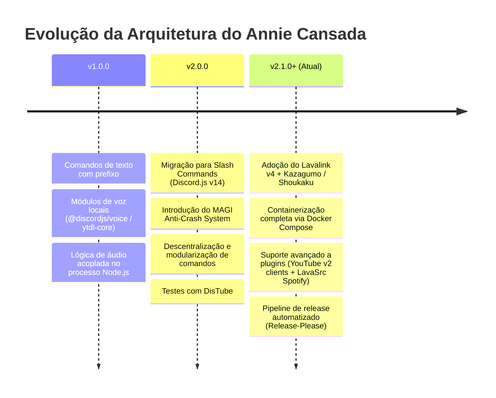
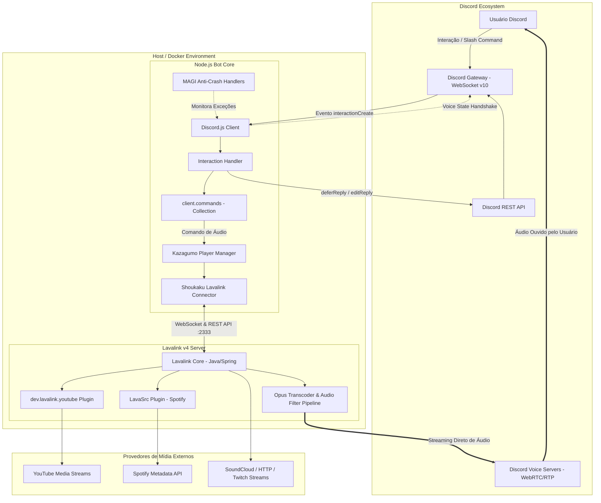
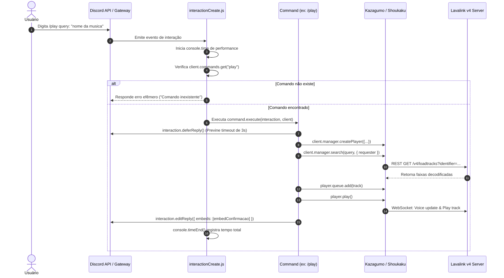
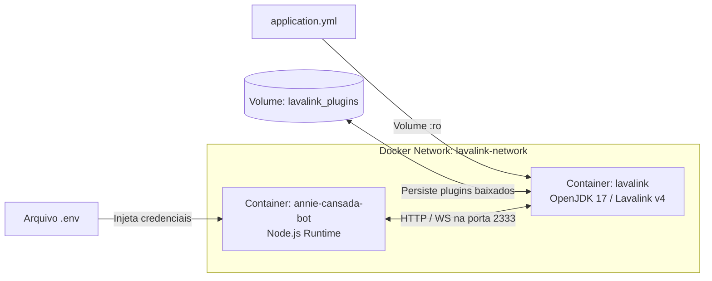
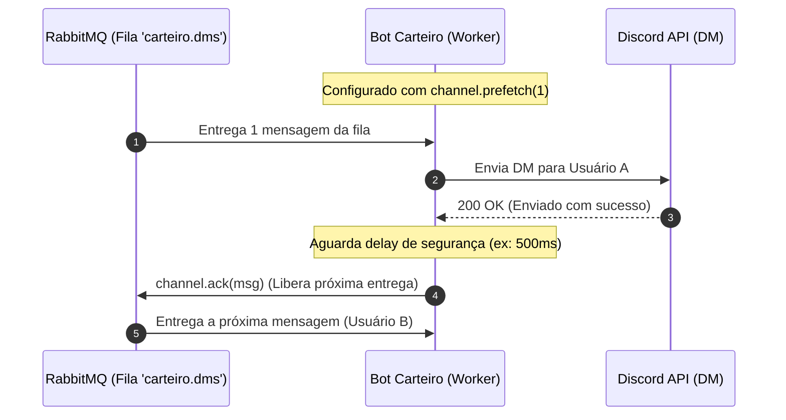
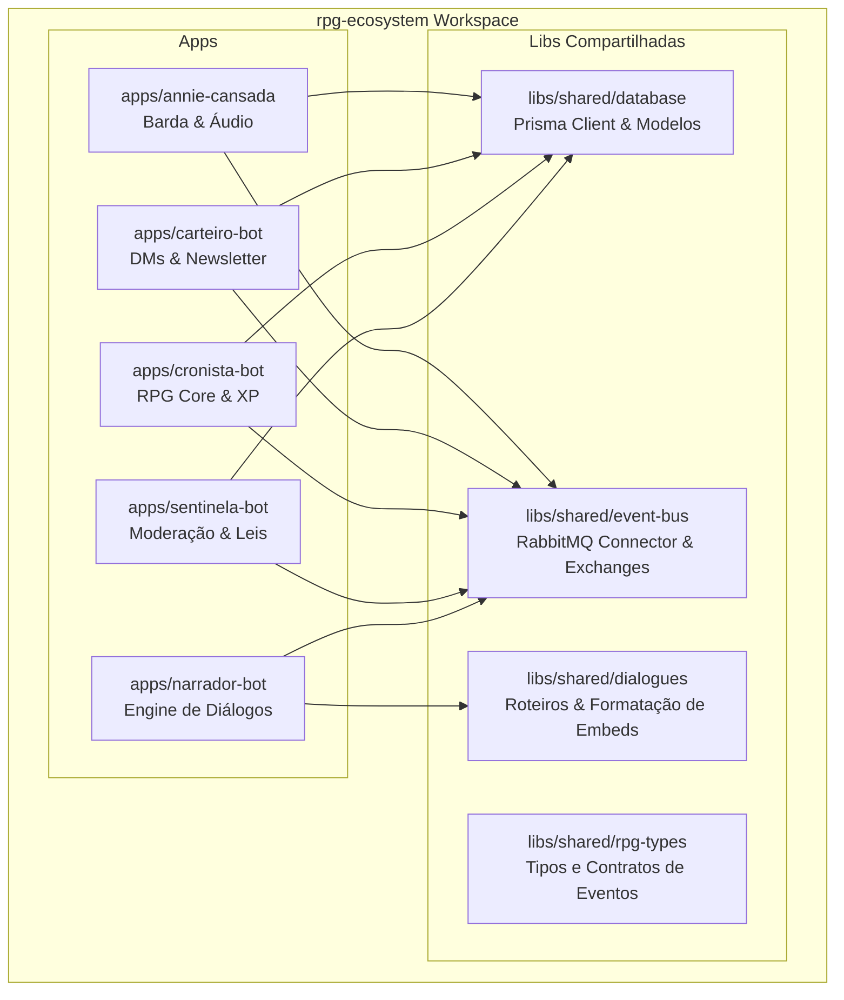

# Arquitetura e Estratégia - Annie Cansada Bot

Documento oficial de referência técnica sobre a estratégia de produto, engenharia de software e arquitetura do **Annie Cansada Bot**.

---

## 1. Visão Geral do Projeto

O **Annie Cansada** é um bot multifuncional para o Discord inspirado na personagem de *Devilline HQ*. O bot combina uma persona única de entretenimento com utilitários práticos, sistemas de RPG, moderação e um player de áudio escalável e desacoplado.

### 1.1 Proposta de Valor e Pilares
* **Alta Disponibilidade e Resiliência:** Arquitetura tolerante a falhas com proteção contínua contra crashes (MAGI Anti-Crash System).
* **Experiência de Áudio Superior:** Desacoplamento do processamento e encoding de áudio via Lavalink v4 com múltiplos provedores e suporte a fallbacks para contornar bloqueios das plataformas.
* **Modularidade Extensível:** Handlers dinâmicos orientados a convenções para comandos, eventos e tratadores de erro.
* **Developer Experience (DX):** Padronização rigorosa via ESLint, Prettier, Husky, Conventional Commits e automação de releases.

---

## 2. Estratégia de Engenharia e Produto

### 2.1 Evolução Histórica das Decisões Técnicas



1. **Desacoplamento de Áudio:** No início, o streaming de áudio era executado diretamente no processo do Node.js utilizando `@discordjs/voice` e `ytdl-core`. Essa abordagem consumia excessiva CPU/RAM para encoding Opus e quebrava frequentemente devido às mudanças constantes do YouTube. A migração para o **Lavalink v4** transferiu essa carga pesada para um nó Java dedicado.
2. **Slash Commands Nativos:** Substituição de comandos por prefixo pelo sistema de interações nativas do Discord (`/commands`), melhorando UX, autocompletion e validação de argumentos pelo próprio cliente do Discord.
3. **Resiliência Ativa:** Implementação de interceptores de exceções para impedir que erros assíncronos não capturados encerrem o processo do bot em produção.

### 2.2 Estratégia de Qualidade e Governança

* **Padronização de Commits:** Utilização do `commitizen` e validação com `commitlint` seguindo a especificação [Conventional Commits](https://www.conventionalcommits.org/).
* **Git Hooks Automáticos:** O `husky` gerencia hooks de:
  * `commit-msg`: Valida o formato da mensagem de commit.
  * `prepare-commit-msg`: Interage com o commitizen CLI.
  * `pre-commit`: Executa o linter (`npm run lint`).
* **Automação de Versionamento:** Workflow de GitHub Actions (`release-please.yml`) que analisa commits convencionais, calcula o SemVer (Patch, Minor, Major), gera o `CHANGELOG.md` e abre PRs de release automaticamente.

### 2.3 Roadmap e Visão de Futuro

| Fase | Iniciativa | Descrição |
| :--- | :--- | :--- |
| **Curto Prazo** | *Limpeza de Legado de Áudio* | Renomear a pasta `Events/Distube/` para ouvintes de ciclo de vida nativos do Kazagumo (`Events/Audio/`), alinhando os nomes dos arquivos aos eventos do player (`playerStart`, `playerEmpty`, etc.). |
| **Médio Prazo** | *Camada de Persistência* | Introduzir banco de dados (SQLite via Prisma/Drizzle ou PostgreSQL) para persistência de preferências de guilda (prefixo, canais padrão, volume salvo, histórico de reprodução e dados do sistema RPG). |
| **Médio Prazo** | *Componentes Interativos* | Expandir respostas com botões (`ButtonBuilder`), menus de seleção (`StringSelectMenuBuilder`) e modais para enriquecer comandos de áudio e RPG. |
| **Longo Prazo** | *Dashboard Web* | Interface web com autenticação Discord OAuth2 para gerenciamento remoto de filas, configurações de servidores e estatísticas em tempo real. |

---

## 3. Arquitetura Atual do Sistema

### 3.1 Diagrama de Arquitetura Global

O sistema adota uma arquitetura em camadas e baseada em microsserviços containerizados:



---

## 4. Detalhamento dos Componentes de Software

### 4.1 Ponto de Entrada (`index.js`)
Responsável pelo bootstrap da aplicação:
1. Instancia o `Client` do Discord.js com intents mínimos necessários (`Guilds`, `GuildMembers`, `GuildMessages`, `GuildVoiceStates`).
2. Configura e conecta o nó Lavalink através do **Kazagumo** e do conector **Shoukaku**.
3. Registra os handlers de eventos (`loadEvents`), comandos (`loadCommands`) e anti-crash (`loadErrorHandler`).
4. Autentica o bot no Discord (`client.login`).

### 4.2 Handlers Dinâmicos (`Handlers/`)

* **`commandHandler.js`:**
  * Escaneia recursivamente as pastas de `commands/` (ignorando pastas inativas).
  * Importa dinamicamente cada comando via ES Modules (`import(...)`).
  * Armazena instâncias na coleção em memória `client.commands`.
  * Registra globalmente os comandos no Discord através de `client.application.commands.set(commandsArray)` no momento do boot.
* **`eventHandler.js`:**
  * Lê recursivamente a pasta `Events/`.
  * Diferencia eventos normais do gateway de eventos REST do Discord (`client.rest`).
  * Associa automaticamente ouvintes usando `client.on()` ou `client.once()`.
* **`errorHandler.js` (MAGI Anti-Crash System):**
  * Intercepta eventos críticos do processo Node.js:
    * `unhandledRejection`: Promises rejeitadas sem tratamento de `.catch()`.
    * `uncaughtException`: Exceções síncronas não capturadas.
    * `uncaughtExceptionMonitor`: Monitoramento em tempo real antes da emissão do erro.
  * Impede o encerramento inesperado do container em produção por erros pontuais de API ou de rede.

### 4.3 Módulos de Comandos (`commands/`)

Os comandos são segregados por domínio funcional:

| Módulo | Finalidade | Principais Comandos |
| :--- | :--- | :--- |
| **`Audio/`** | Controle completo de reprodução musical via Lavalink | `/play`, `/pause`, `/resume`, `/skip`, `/queue`, `/loop`, `/shuffle`, `/timeline`, `/volume`, `/leave`, `/stop` |
| **`Fun/`** | Entretenimento e piadas | `/piada` (piadas categorizadas via `Data/dataPiadas.js`) |
| **`Info/`** | Diagnóstico, status e dados informativos | `/botinfo`, `/ping`, `/uptime`, `/server`, `/user`, `/help` |
| **`RPG/`** | Utilitários de rolagem de dados e RPG de mesa | `/1d6` (rolagem de dados customizada) |
| **`Utility/`** | Utilitários gerais | `/defina` (dicionário via API externa) |
| **`moderation/`** | Gerenciamento de canais e manutenção do bot | `/clear` (limpeza de mensagens em lote), `/reload` (recarregamento a quente de comandos) |
| **`Inativos/`** | Rascunhos e comandos temporariamente desativados | `ban.txt`, `kick.txt` |

---

## 5. Fluxo de Execução de um Slash Command

O diagrama abaixo ilustra o ciclo de vida completo de uma interação disparada pelo usuário, destacando o padrão assíncrono para evitar o timeout de 3 segundos imposto pela API do Discord:



---

## 6. Arquitetura de Áudio (Lavalink v4 & Plugins)

### 6.1 Por que Lavalink v4?
Ao contrário de bibliotecas in-process tradicionais, o Lavalink atua como um servidor de áudio headless independente. As principais vantagens arquiteturais são:
* **Offloading de CPU:** Transcodificação e encoding Opus realizados em Java com threads dedicadas, sem bloquear o Event Loop do Node.js.
* **Resiliência a reinicializações:** O bot pode ser reiniciado em desenvolvimento (`nodemon`) mantendo a conexão de voz ativa caso configurado o session resume.
* **Diversidade de Fontes com Plugins Oficiais:**
  * **`youtube-plugin` (v1.11.4):** Emprega múltiplos clientes de rotação (`MUSIC`, `WEB`, `TVHTML5EMBEDDED`, `ANDROID_LITE`, etc.) para contornar bloqueios e restrições de IP.
  * **`lavasrc-plugin` (v4.4.1):** Habilita resolução de metadados do Spotify diretamente para streaming compatível.

---

## 7. Infraestrutura e Ambientes de Execução

### 7.1 Docker Compose Topology



* **Rede Interna:** A comunicação entre o bot e o Lavalink ocorre via rede interna bridge (`lavalink-network`), sem a necessidade de expor a porta `2333` do Lavalink para a máquina host em produção.
* **Volume de Plugins:** O diretório de plugins do Lavalink é persistido em um volume nomeado (`lavalink_plugins`), evitando que os plugins sejam baixados a cada inicialização do container.

---

## 8. Arquitetura Multi-Bot & Ecossistema Distribuído

Esta seção documenta a estratégia para expandir a Annie Cansada de um bot único para um **ecossistema de múltiplos bots temáticos de RPG**, que cooperam entre si por meio de mensageria para criar uma experiência de MMORPG e automação no Discord.

### 8.1 A "Party" de Bots: Arquétipos de Fantasia e Funções Técnicas

Cada bot do ecossistema possui uma persona viva inspirada em histórias de fantasia medieval, mas no backend executa uma responsabilidade de software estritamente isolada:

| Personagem / Arquétipo | Nome / Persona | Papel no MMORPG (Lore) | Papel Técnico no Backend |
| :--- | :--- | :--- | :--- |
| **A Barda / Aventureira** | **Annie Cansada** | Anfitriã da taverna, barda de histórias e músicas que comanda o palco público. | **Interação em Servidores e Áudio (Lavalink v4)**: Recebe slash commands, gerencia o player de música e introduz novos jogadores. |
| **O Ladino / Mensageiro Alado** | **O Carteiro** | O mensageiro furtivo que viaja pelas sombras para entregar cartas lacradas e itens raros. | **Disparo Controlado de DMs & Newsletter**: Consome filas RabbitMQ com limitação estrita de taxa (pacing) para não atingir rate limits. |
| **O Mago / Arquivista** | **O Cronista** | O sábio que guarda a história do mundo, pergaminhos de missões e calcula o destino dos heróis. | **Lógica de RPG & Banco de Dados**: Controla fichas de personagens, cálculo de XP, atributos e gerenciamento de missões (PostgreSQL). |
| **O Paladino / Guardião** | **O Sentinela** | O cavaleiro de armadura pesada que protege a taverna e pune quem quebra as leis da guilda. | **Moderação & Segurança**: Monitora logs de auditoria, filtros de spam/links maliciosos e punições temáticas (confinamento em masmorra). |
| **O Alquimista / Mercador** | **O Taverneiro** | O comerciante de poções, equipamentos e jogos de aposta e dados na mesa da taverna. | **Economia & Gacha**: Gerencia ouro, inventário de itens, loja virtual e minigames de sorte. |
| **O Menestrel / Narrador** | **O Narrador** (Ícone: 💬) | A voz descritiva do mundo, responsável por exibir conversas e cenas dramáticas entre os personagens. | **Engine de Diálogos**: Renderiza conversas entre os personagens via múltiplos embeds encadeados, webhooks dinâmicos ou emojis de avatar. |

```mermaid
graph TB
    subgraph Discord Gateway & Canais
        User[Jogador / Usuário]
        CanalChat[Canal de Texto #taverna]
        UserDM[Chat Privado / DM]
    end

    subgraph "Party" de Bots (Node.js Containers)
        Annie[Annie Cansada\nBarda / Áudio]
        Carteiro[O Carteiro\nLadino / DMs]
        Cronista[O Cronista\nMago / RPG Logic]
        Sentinela[O Sentinela\nPaladino / Moderação]
        Narrador[O Narrador\nEngine de Diálogos]
    end

    subgraph Infraestrutura Central
        RabbitMQ[Message Broker\nRabbitMQ - Topic Exchanges]
        DB[(Banco de Dados\nPostgreSQL Unificado)]
    end

    User -->|/missao ou /play| Annie
    Annie -->|Publica evento 'missao.concluida'| RabbitMQ
    RabbitMQ -->|Roteia evento| Cronista
    RabbitMQ -->|Roteia evento| Carteiro
    RabbitMQ -->|Roteia evento| Narrador

    Cronista -->|Atualiza XP e Ficha| DB
    Carteiro -->|Consome fila com prefetch 1| UserDM
    Narrador -->|Renderiza diálogo da história| CanalChat
```

---

### 8.2 O que é um WebSocket?

O **WebSocket** é um protocolo de comunicação que estabelece uma **conexão contínua, aberta e bidirecional (full-duplex)** entre dois sistemas sobre uma única conexão TCP.

* **Comparação com HTTP Tradicional:**
  * No **HTTP**, a comunicação funciona como "fazer uma pergunta e receber uma resposta". O cliente faz uma requisição (`GET` / `POST`), o servidor responde e a conexão é encerrada. Se o servidor tiver novidades mais tarde, ele não pode avisar o cliente espontaneamente — o cliente teria que ficar perguntando repetidamente (*polling*).
  * No **WebSocket**, a comunicação funciona como uma **ligação telefônica**. Uma vez estabelecida a conexão (handshake), ambos os lados podem falar ou ouvir a qualquer momento, sem precisar abrir novas conexões a cada mensagem.
* **Uso típico de WebSockets:** Chats em tempo real, dashboards ao vivo, jogos multiplayer e o próprio *Gateway do Discord* (que envia eventos em tempo real para os bots).

---

### 8.3 Análise e Comparativo de Tecnologias de Comunicação Inter-Bots

Ao projetar múltiplos bots que precisam colaborar, foram avaliados os seguintes padrões:

| Tecnologia | Como Funciona | Prós | Contras | Quando Usar? |
| :--- | :--- | :--- | :--- | :--- |
| **RabbitMQ (AMQP Broker)** *(Decisão Arquitetural)* | Message Broker corporativo com roteamento avançado por Exchanges (Direct, Topic, Fanout) e confirmações (ACK). | • **Roteamento por Tópicos:** Annie publica `rpg.missao.*` e múltiplos bots recebem simultaneamente.<br>• **Interface Web Nativa:** Painel de gestão completo na porta `15672`.<br>• Suporta filas mortas (Dead-Letter Exchanges) e controle de prefetch. | • Consumo de memória moderado (~100MB-200MB de RAM na JVM Erlang).<br>• Configuração mais detalhada com `amqplib`. | **Ideal para ecossistemas multi-bot complexos onde eventos afetam múltiplos serviços ao mesmo tempo.** |
| **Redis + BullMQ (Fila)** | Fila de tarefas para Node.js rodando sobre o banco em memória Redis. | • Controle nativo de velocidade (`rateLimiter`).<br>• Muito leve (~20MB-30MB de RAM) e com tipagem TypeScript fluida. | • O Redis é um banco em memória; roteamento entre múltiplos serviços não é tão poderoso quanto o RabbitMQ Topic Exchange. | **Ideal para aplicações Node.js simples focadas exclusivamente em filas de tarefas.** |
| **WebSockets (Socket.io / ws)** | Conexão TCP aberta e direta entre os bots ou através de um Hub central. | • Latência ultrabaixa em milissegundos e bidirecional. | • **Sem buffer/persistência nativa:** Se o bot destino reiniciar, perde a mensagem. | **Ideal para sincronização em tempo real com Dashboards Web.** |
| **Pub/Sub Leve (Redis Pub/Sub)** | Modelo "rádio": um bot transmite e quem estiver ouvindo no momento recebe. | • Extremamente rápido e simples. | • *Fire-and-forget*: se o bot estiver offline no instante do envio, a mensagem se perde. | Notificações de status instantâneas e descartáveis. |

---

### 8.4 Blindagem contra Rate Limits no Discord: O Carteiro com RabbitMQ

O envio massivo de mensagens diretas (DMs) para newsletters ou recompensas de RPG sofre com limites rígidos impostos pelo Discord. A arquitetura adota o padrão **`channel.prefetch(1)`** com confirmação de entrega (**ACK**) e ritmo controlado (**Pacing**):



1. **Freio de Mão (`prefetch: 1`):** O RabbitMQ só entrega uma nova mensagem ao Carteiro após a anterior ser concluída e confirmada via `channel.ack(msg)`.
2. **Pacing Seguro:** Um atraso programado (ex: 500ms) após cada envio garante um teto de 2 DMs por segundo, muito abaixo do radar de punição do Discord.
3. **Tratamento de Erros `429 Too Many Requests`:** Se o Discord solicitar pausa, o Carteiro suspende o loop pelo tempo indicado no cabeçalho `retry_after` e reenvia a mensagem sem descartar nada da fila.
4. **Dead-Letter Exchange (DLX):** Usuários que desativaram DMs (erro `50007`) são direcionados para uma fila morta, permitindo que o sistema atualize o banco de dados e interrompa envios futuros a eles.

---

### 8.5 O Bot Narrador: Padrões Visuais de Diálogo

Para criar a experiência de "chat/conversa" entre dois ou mais personagens (ex: Annie e o Carteiro interagindo), o Bot Narrador utiliza 3 abordagens complementares:

#### Padrão 1: Múltiplos Embeds na Mesma Mensagem (Carrossel Nativo)
O Discord permite o envio de **até 10 embeds em uma única chamada de mensagem**. Os embeds aparecem empilhados de forma contínua, permitindo personalizar as cores e os avatares de cada personagem:

* **Embed 1 (Annie Cansada - Borda Roxa):**
  * `Author`: Ícone da Annie + Nome `"Annie Cansada"`.
  * `Description`: `> "Ugh... você demorou, Carteiro. Onde estão os relatórios das masmorras?"`
  * `Thumbnail`: Imagem do rosto da Annie no canto superior direito.
* **Embed 2 (O Carteiro - Borda Azul):**
  * `Author`: Ícone do Carteiro + Nome `"O Carteiro"`.
  * `Description`: `> "Perdão, senhorita Annie! O caminho da montanha estava infestado de slimes..."`
  * `Thumbnail`: Imagem do rosto do Carteiro no canto superior direito.

```javascript
// Exemplo em Discord.js v14:
await channel.send({ embeds: [embedAnnie, embedCarteiro] });
```

#### Padrão 2: Webhooks Dinâmicos (Modo "Teatrinho")
O bot Narrador utiliza a API de Webhooks do canal para postar mensagens sucessivas personificando cada bot com seu **nome e foto de perfil próprios**:
* O webhook posta com `username: "Annie Cansada"` e `avatarURL: urlAnnie`.
* No segundo seguinte, o mesmo webhook posta com `username: "O Carteiro"` e `avatarURL: urlCarteiro`.
* **Resultado:** No canal, a sensação visual é a de dois bots ou pessoas reais conversando dinamicamente.

#### Padrão 3: Embed Único com Emojis Customizados de Avatar
Para diálogos rápidos ou citações compactas em um único embed:
> 📜 **Diálogo na Taverna**  
> <:annie_rosto:12345> **Annie Cansada:** *"Não acredito que você perdeu a carta..."*  
> ╰┈➤ <:carteiro_rosto:67890> **O Carteiro:** *"Ela só caiu no ninho de um grifo!"*  
> <:annie_rosto:12345> **Annie Cansada:** *"Vá buscar antes do anoitecer."*

---

### 8.6 Estrutura de Repositório: Monorepo com Nx

O ecossistema adota a arquitetura de **Monorepo com [Nx](https://nx.dev/)** para garantir compartilhamento imediato de modelos de dados e contratos de eventos entre todos os bots:



#### Benefícios do Nx Monorepo:
1. **Contratos Tipados de Eventos:** Se o payload do evento `rpg.missao.concluida` for alterado, o TypeScript aponta instantaneamente os ajustes necessários em todos os bots produtores e consumidores.
2. **Banco de Dados Único:** O schema do Prisma é mantido em `libs/shared/database` e consumido por todos os bots sem duplicação de migrations.
3. **Builds Incrementais (`nx affected`):** Durante o CI/CD, apenas os bots cujos códigos ou dependências foram alterados passam por lint, build e deploy.
4. **Orquestração Local:** O `docker-compose.yml` unificado inicia toda a infraestrutura (5 bots + Lavalink + RabbitMQ + PostgreSQL) de forma consistente.

---

## 9. Segurança e Boas Práticas

1. **Gestão de Segredos:**
   * Tokens e credenciais sensíveis (`DISCORD_TOKEN`, `LAVALINK_PASSWORD`, `SPOTIFY_CLIENT_SECRET`, strings de conexão de bancos ou Redis) são injetados exclusivamente via variáveis de ambiente (`.env`), que é explicitamente ignorado no `.gitignore`.
2. **Case-Sensitivity de Imports:**
   * O ambiente de produção é Linux e roda em containers. Todas as importações de arquivos devem respeitar rigorosamente a capitalização dos diretórios (`Data/`, `Handlers/`, `Utils/`, `commands/`).
3. **Tratamento de Timeout de Interações:**
   * Qualquer comando que faça I/O assíncrono (Lavalink, chamadas HTTP externas ou processamento de imagens) deve obrigatoriamente chamar `await interaction.deferReply()` logo no início de `execute()`.
4. **Resiliência em Respostas de Erro:**
   * Toda captura em blocos `catch` verifica o estado da resposta (`interaction.deferred || interaction.replied`) para selecionar dinamicamente entre `editReply()` ou `reply()`, evitando o erro clássico `InteractionAlreadyReplied`.

---

## 10. Manutenção e Contribuição

Para diretrizes detalhadas de código e instruções passo a passo para agentes de inteligência artificial ou desenvolvedores, consulte também:
* [AGENTS.md](./AGENTS.md): Regras de desenvolvimento, padrões de Slash Commands e convenções de código.
* [README.md](./README.md): Instruções de scripts NPM e execução do projeto.
* [CHANGELOG.md](./CHANGELOG.md): Histórico completo de versões e modificações.

